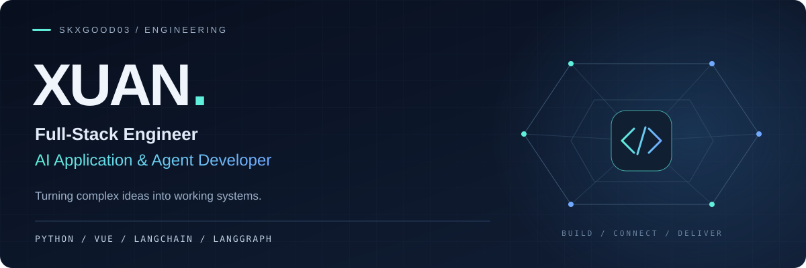

  

  <strong>全栈交付 · Agent 工作流 · AI 工程实践</strong> 
  Backend depth. Product thinking. An AI engineering mindset.

  <a href="https://ethan-python-ai.primelarch16.chatgpt.site"><strong>个人博客 · Blog ↗</strong></a> &nbsp; · &nbsp;
  <a href="https://github.com/skxgood03?tab=repositories">Projects ↗</a>

---

## From idea to system.

I connect **Python backends**, **web interfaces**, and **language models** to build software around real problems — from system design and implementation to deployment and iteration.

<table>
<tr>
<td width="33%" valign="top">

### 01 / SYSTEMS
**Backend &amp; Full Stack**

APIs, business logic, data processing, and Vue interfaces.

Python · Django · Flask · FastAPI · Vue 3

</td>
<td width="34%" valign="top">

### 02 / INTELLIGENCE
**AI Applications &amp; Agents**

Exploring tool use, stateful orchestration, and context management.

LangChain · LangGraph · LLM APIs

</td>
<td width="33%" valign="top">

### 03 / DELIVERY
**AI-Assisted Engineering**

AI coding agents across planning, implementation, debugging, and iteration.

Git · Linux · Docker · Nginx

</td>
</tr>
</table>

## Selected engineering work

**[Vue3Admin ↗](https://github.com/skxgood03/Vue3Admin)**  
Web administration interface built with **Vue 3 &amp; TypeScript**.

**[DBSC ↗](https://github.com/skxgood03/DBSC)**  
Multibeam sounding software combining **TCP data acquisition, multithreaded processing, SQLite storage, and scientific visualization**.  
Python · PyQt5 · NumPy · SciPy

## On my radar

**Agent orchestration · Context engineering · Tool integration · Reliable AI applications**

I'm deepening my understanding of how models, tools, state, and application logic fit together — and how to turn that understanding into useful products.

<strong>More of my stack</strong>

 

**Frontend** — JavaScript · TypeScript · Vue 3 · Vite  
**Data** — MySQL · PostgreSQL · Redis · Pandas  
**Infrastructure** — Linux · Docker · Nginx · Shell

---

  <strong>Build with intent. Ship with care.</strong> 
  Basketball · Strength training · Books · Technology &amp; entrepreneurship  
  <a href="https://ethan-python-ai.primelarch16.chatgpt.site">Read my blog →</a> &nbsp; · &nbsp;
  <a href="https://github.com/skxgood03?tab=repositories">Explore my repositories →</a>

